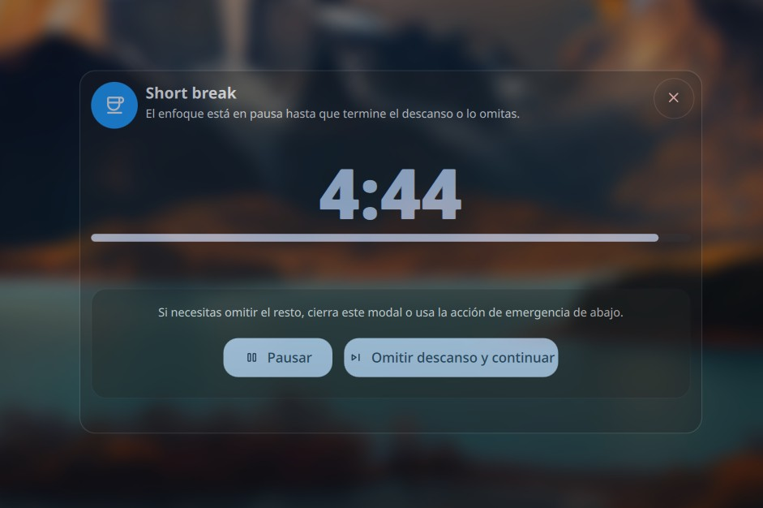
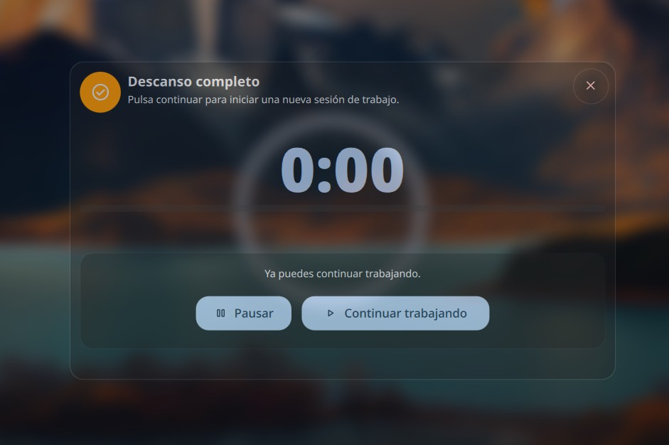
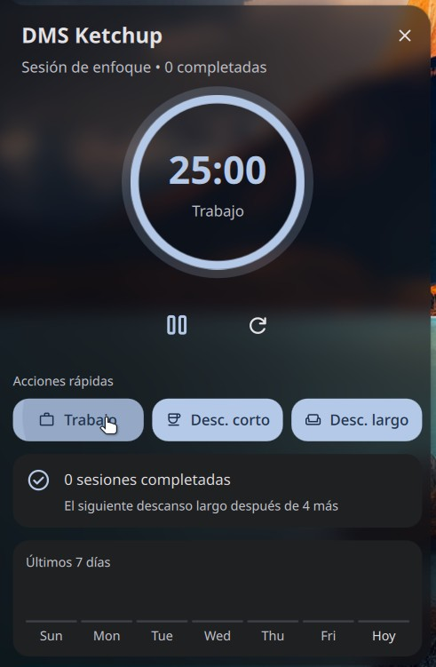
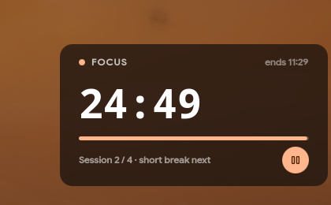

# DMS Ketchup

DMS Ketchup is a fork of [Dank Pomodoro Timer](https://github.com/AvengeMedia/dms-plugins/tree/main/DankPomodoroTimer) for DMS.

It keeps the original Pomodoro idea, but rebrands it for DMS and adds a more polished break experience, tighter visuals, and a few workflow improvements.

This fork was developed with vibe coding. I’m saying that explicitly because I want to be transparent about it.

## What changed from the original

- Rebranded from Dank Pomodoro Timer to DMS Ketchup
- Renamed the internal plugin id to `dmsKetchup`
- Added a dedicated break modal with pause / resume support
- Added a skip-break-and-continue action
- Added Spanish/English UI text
- Added theme-aware tomato icons for the inactive state
- Added custom sounds for session start/end
- Added a transparent floating modal style that fits DMS
- Added a cleaner inactive state for the bar panel
- Added a live lock-screen study timer with manual start/stop controls
- Added media pausing for the whole break, not only at the moment it starts
- Added smarter unlock handling: a live session continues, while an idle or paused timer starts fresh at the full duration

## New additions

- Dark/light themed tomato icon assets
- Break modal with pause/resume and continue controls
- Translated settings panel and modal strings
- Windowed modal behavior compatible with DMS transparency
- A dedicated “no timer active” icon state
- Lock-screen card shows live time, finish time, session number and the next break
- Locking no longer interrupts a focus block when "Start pomodoro on unlock" is enabled

## Screenshots

Panel view:

Break modal:

Break modal close-up:

Lock-screen study timer:

## Upstream

Original project: [Dank Pomodoro Timer](https://github.com/AvengeMedia/dms-plugins/tree/main/DankPomodoroTimer)

Repository: https://github.com/AvengeMedia/dms-plugins

Upstream plugin path: `DankPomodoroTimer`

This fork: https://github.com/jw2122/dms-ketchup

## Notes

- This fork preserves DMS plugin loading compatibility.
- The visible plugin name is `DMS Ketchup`.
- The technical plugin id is `dmsKetchup`.
- The implementation remains close to the original structure, but the UI and behavior are tuned for DMS.
